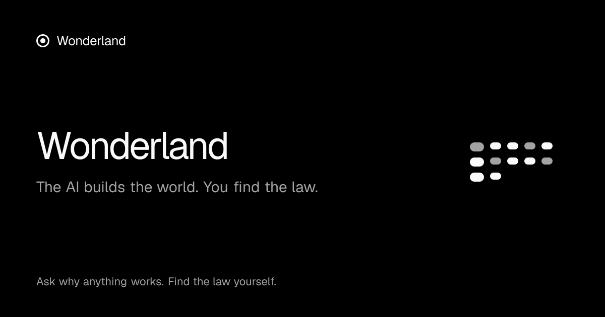

# Wonderland



**AI that builds the world, not the answer.**

Type any *why* or *how* — "Why does SQL injection work?", "How does natural selection make camouflage?", "Why do bank runs happen?" — and a team of agents built on Meta's models creates a **playable, scientifically verified world** around a **hidden law**. You discover it yourself by predicting and experimenting. The AI never tells you. Then you prove it on a situation you've never seen, racing **Ada**, an AI rival running on Meta open weights.

Built for the [Meta Global AI Developer Hackathon](https://cerebralvalley.ai/e/meta-ai-developer-hackathon) (Oct 26 – Nov 4, 2026) · Indie Developer track · theme *Build for Your World*.

## Why
People who learn with AI assistance understood less: 50% vs 67% in a 2026 randomized trial. Discovery-first learning is one of the strongest effects in education research, but great interactive simulations take experts months each. Wonderland makes them in minutes — and makes sure the AI does the building while **you** do the thinking. → [docs/design.md](docs/design.md)

## Meta models, each doing real work
| Model | Job |
|---|---|
| **Muse Wonder 1.0** | Designs each world and repairs it until it passes its science checks |
| **Muse Spark 1.3** | Scientist (finds the hidden law + checks), judge (never reveals it), watches playtest recordings |
| **Muse Image 1.0** | Paints every world and character |
| **SAM 3.1** | Cuts characters out of the paintings to make game sprites |
| **Muse Voice Transcribe** | You say your hypothesis out loud |
| **Muse Glimmer / Muse Spark Open** | Ada the AI rival and the 40 citizens of Rumour Town (via Fireworks / Baseten) |

## Hero worlds
| World | Concept | Under the hood |
|---|---|---|
| The Gatekeeper's Ledger | SQL injection | A **real SQLite** engine (sql.js) — the exploit is real, sandboxed |
| Peppered Forest | Natural selection | Heritable variation + selective predation |
| Newton's Cannon | Orbits | Velocity-Verlet gravity |
| Rumour Town | Bank runs | Diamond–Dybvig; citizens powered by Muse Glimmer |
| The Firebreak | Why fires spread | Site percolation on a grid — a spark crosses only when the trees connect |

Every world must pass machine-checked science assertions on every seed before it ships (`pnpm test`).

## Live models, and running without keys
With a Baseten key alone, Wonderland's whole brain runs on **Muse Spark Open** (Meta's open weights): the scientist and designer that write new worlds, the judge, Ada, the forty citizens of Rumour Town, and spoken hypotheses (Spark Open hears audio). With a Meta Model API key, the scientist and designer move to Muse Spark / Muse Wonder, and Muse Image + SAM 3.1 paint and cut the art.

Every call passes a hard spend cap (`SPEND_CAP_META_USD`, `SPEND_CAP_BASETEN_USD`; ledger in `.spend/`). With no keys at all, each call takes a clearly labeled sample path and the hero worlds still play.

**Generated so far** (`data/worlds`, all passed every science check): fireflies flashing in sync, phantom traffic jams, predator–prey cycles, heat in a metal plate. See [docs/spike-results.md](docs/spike-results.md).

## Design
Black and white, with colour only inside the worlds. Geist, shadcn/ui, real logos, one orchestrated entrance, and a live world running in the landing page's product window. Rules for anyone changing the UI: [docs/design/system.md](docs/design/system.md).

## Run it
```bash
pnpm install
cp .env.example .env.local   # add MODEL_API_KEY, FIREWORKS_API_KEY (and/or BASETEN_API_KEY)
pnpm check                   # typecheck + lint + science checks
pnpm smoke                   # one live call to every model
pnpm dev                     # http://localhost:3000
pnpm spike                   # generate 10 worlds from scratch and report how many verify
```

## Repo map
```
src/engine/     WorldSpec contract, seeded RNG, runtime, science checks
src/worlds/     hand-authored hero worlds (spec + rules)
src/agents/     generation pipeline + prompts (scientist, designer, judge, rival)
src/lib/ai/     model ids, provider clients, Meta API wrappers, SAM parser
src/app/        Next.js app + API routes (generate, judge, rival, transcribe, worlds)
scripts/        smoke test + generation spike
docs/           design, architecture, demo script, research
plan.md         build plan for the agent team
```

## Built during the hackathon
Everything in this repository was created from Oct 26, 2026 onwards. See the commit history.
