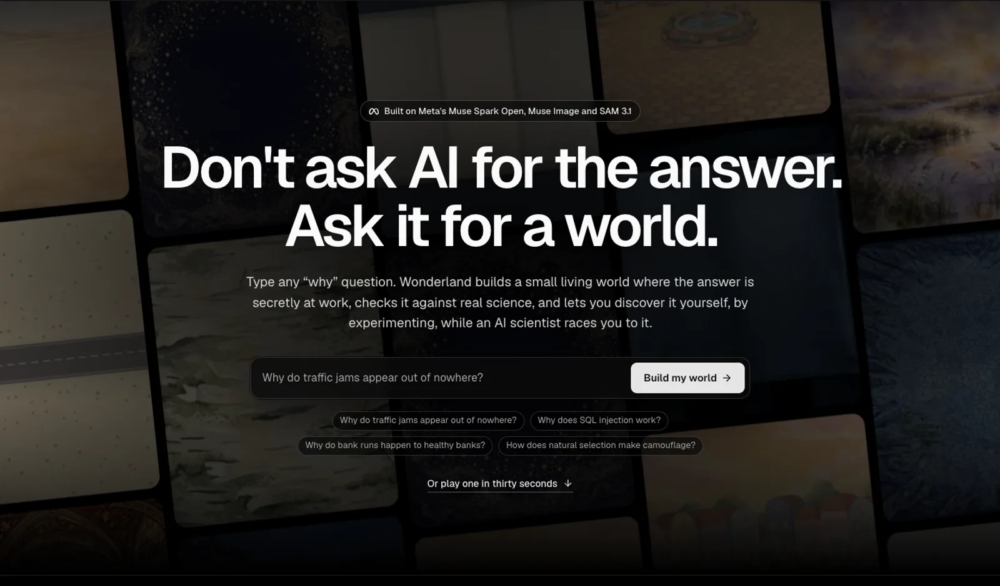
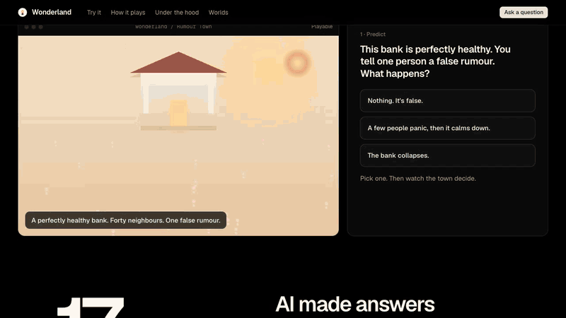
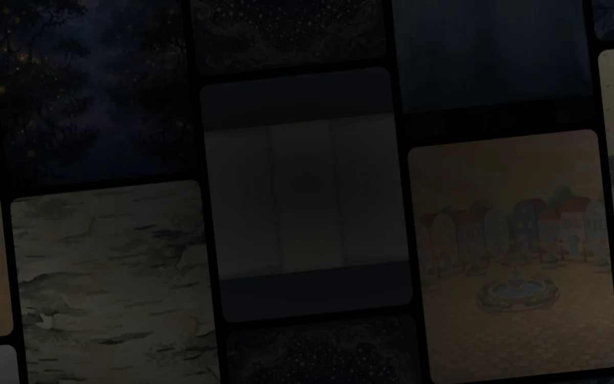
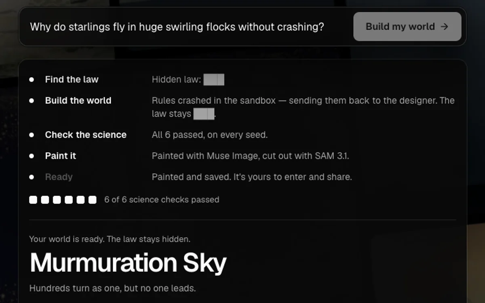
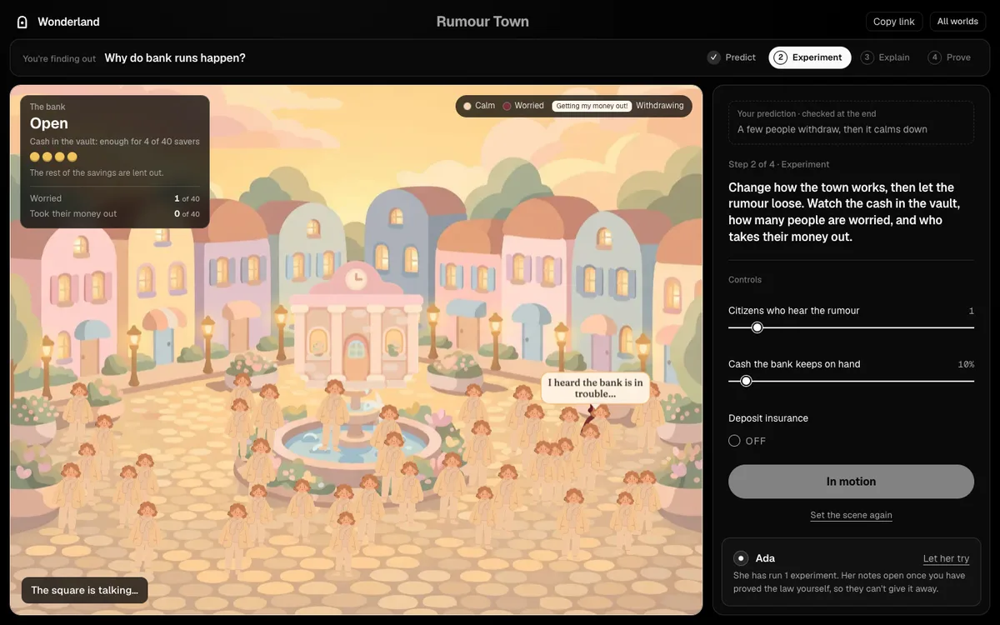
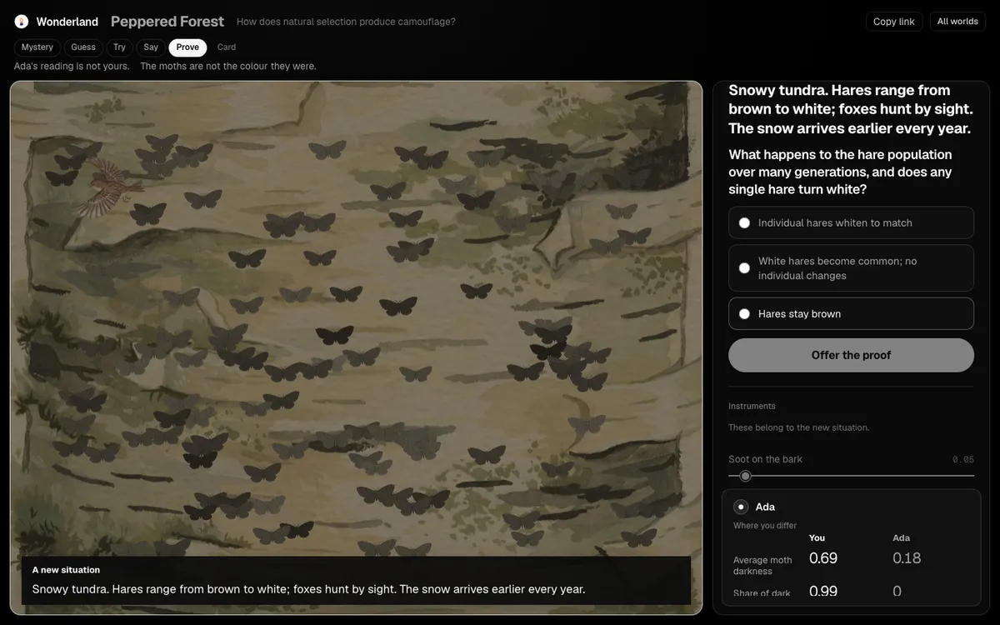
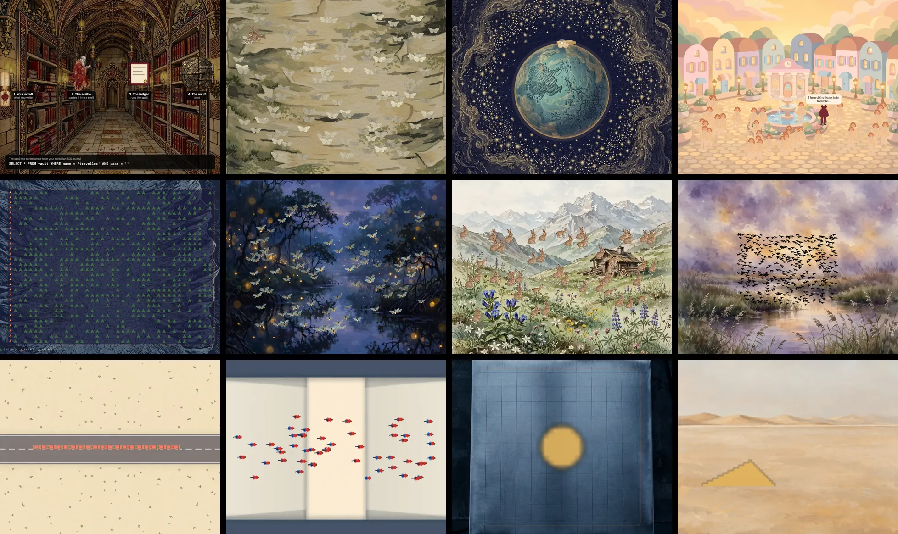
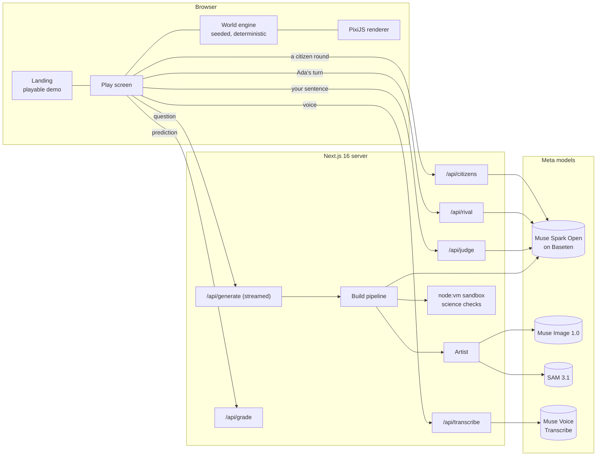
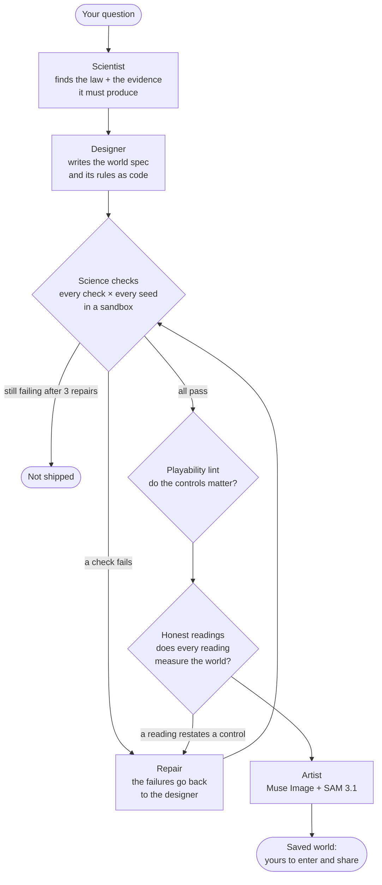
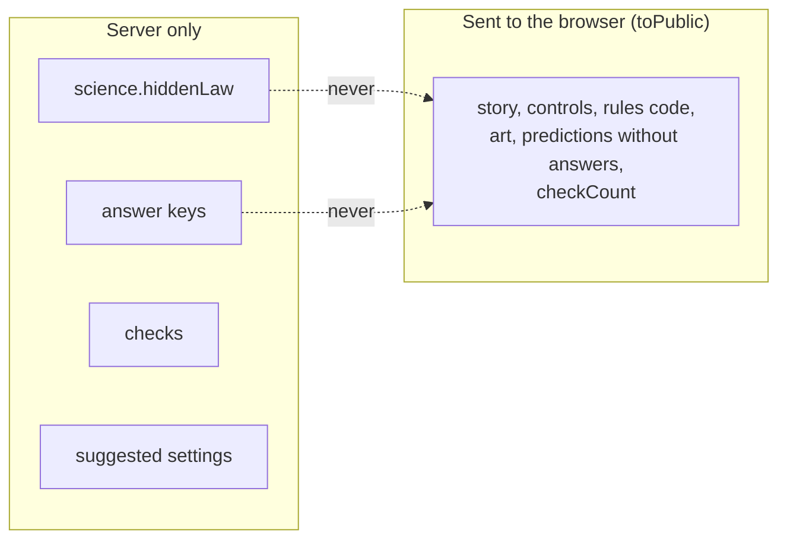

<p align="center">
  
</p>

<h1 align="center">Wonderland</h1>

<p align="center"><b>Don't ask AI for the answer. Ask it for a world.</b></p>

<p align="center">
  Type any <i>why</i> question. Wonderland builds a small living world where the answer is secretly at work,<br />
  checks it against real science, and lets you discover it yourself, while an AI scientist races you to it.
</p>

<p align="center">
  <a href="https://wonderland-omega-fawn.vercel.app"><b>▶ Play it live: wonderland-omega-fawn.vercel.app</b></a>
</p>

<p align="center">
  
  
  
  
  
  
</p>

<p align="center">
  
</p>

---

**Built for the [Meta Global AI Developer Hackathon](https://cerebralvalley.ai/e/meta-ai-developer-hackathon) (Oct 26 – Nov 4, 2026) · Indie Developer track · solo.** Everything in this repository was written during the hackathon; see the commit history.

## Contents

- [The idea in thirty seconds](#the-idea-in-thirty-seconds)
- [Why this matters](#why-this-matters)
- [How it plays](#how-it-plays)
- [The worlds](#the-worlds)
- [Under the hood](#under-the-hood)
  - [A team of Meta models](#a-team-of-meta-models)
  - [How a world is built and verified](#how-a-world-is-built-and-verified)
  - [How a world is painted](#how-a-world-is-painted)
  - [The hidden law stays hidden until you find it](#the-hidden-law-stays-hidden-until-you-find-it)
  - [Running AI-written code safely](#running-ai-written-code-safely)
  - [A hard ceiling on spend](#a-hard-ceiling-on-spend)
- [Run it yourself](#run-it-yourself)
- [Repository map](#repository-map)
- [Design](#design)
- [What's next](#whats-next)

## The idea in thirty seconds

<p align="center">
  
</p>

That's the landing page's playable demo, recorded as is. A perfectly healthy bank, forty neighbours, one false rumour. You predict what happens, watch the bank fall, then go looking for the one change that saves it. Keeping more cash doesn't do it. Hiding the queue doesn't do it. Guaranteeing deposits does, because nobody needs to run first. You just discovered the core of the [Diamond–Dybvig model](https://en.wikipedia.org/wiki/Diamond%E2%80%93Dybvig_model), and nobody told you.

**Every Wonderland world works that way, about anything you ask.** Ask *"Why do fireflies end up flashing in sync?"* and about two minutes later you're standing in a painted mangrove at dusk with a hundred fireflies, three controls and a hidden rule to find.

## Why this matters

> **−17 points** on a test of understanding, for people who learned a new skill with an AI assistant instead of working it out themselves.
> <sub>Randomised trial, 52 engineers. Shen &amp; Tamkin, Anthropic, 2026.</sub>

AI made answers free. Understanding still has to be earned: decades of learning research agree that what you work out yourself sticks, and what you're told fades. Answer engines skip exactly the part that makes you understand.

Wonderland keeps the AI and flips its job. **The models do the building, the science and the art. You do the thinking.** The hidden law never reaches your screen, or even your browser's network traffic, until a judge agrees you've found it. Then, and only then, you get it in plain words. It is never printed on the card you share.

Great interactive simulations exist ([PhET](https://phet.colorado.edu/), [Explorable Explanations](https://explorabl.es/)), but each one takes experts weeks. Wonderland makes a new one, verified, in about two minutes, for any question a learner actually has.

**Who it's for:** learners who want to understand rather than just know; teachers who'd rather send a class a world than a worksheet (everyone gets the same link and the same law, and each student keeps a card showing how long it took); and anyone with a question they've wondered about for years.

## How it plays

| | |
|:--|:--|
|  |  |
| **1. Ask why anything works.** Bank runs, camouflage, orbits, SQL injection, traffic jams. Any question about how something works is the seed of a world. | **2. Watch it get built, and checked.** Muse Spark Open finds the real law, designs a world around it and writes its rules as code. The code is run on every seed against the science; the law is shown only as `███`. |
|  |  |
| **3. Experiment until you see it.** Predict, change one thing, run it again. Ada, an AI scientist on the same world, is racing you, and she only moves after you do. | **4. Say it, then prove it.** Put the law into words, typed or spoken. A judge model tells you how close you are without ever saying the answer. Then a situation you haven't seen tests whether you really understood. |

At the end the law you found is shown in plain words (*"What you discovered"*), and you keep a card, shareable with its own preview image, showing your prediction before and after and how long the discovery took. The law itself is not on the card, so sharing it never spoils the world for anyone else.

Every screen says where you are: a bar across the top shows **what you're finding out** and the four steps (Predict, Experiment, Explain, Prove); the panel shows only the current step with a plain instruction written for that world; readings appear **on the stage**, where you're looking (Rumour Town shows the cash in the vault as coins draining away). Ada's notes stay folded until you've proved the law yourself, so she can never give it away.

## The worlds

**Twenty-five worlds, five built by hand.** The other twenty were written and painted by Meta's models from a single typed question.
- **The first seven** were saved because their science checks passed on every seed. Six of them were later **repaired by hand**: we found the models had faked some readings, and the checks hadn't noticed. [What happened, and the check we added so it can't happen again](#when-the-checks-were-fooled).
- **The other thirteen** come from the fresh-question eval, the Lab and one live build from the landing page. They passed all four gates with no hand repairs; five were fixed by the automatic repair loop.

| World | The question | What's really running |
|---|---|---|
| **The Gatekeeper's Ledger** | Why does SQL injection work? | A real SQLite engine ([sql.js](https://sql.js.org)) in your browser. The exploit is real, and sandboxed. |
| **Peppered Forest** | How does natural selection make camouflage? | Heritable variation and selective predation over generations; soot changes the bark. |
| **Newton's Cannon** | How do orbits work? | Velocity-Verlet gravity. Fire fast enough and you never land. |
| **Rumour Town** | Why do bank runs happen to healthy banks? | Diamond–Dybvig, with forty citizens whose words are written by Muse Spark Open each round. |
| **The Firebreak** | Why does one spark sometimes take the whole valley? | Site percolation on a grid: fire crosses only when the trees connect. |
| *The Meadow That Blinks As One* | Why do fireflies flash in sync? | Coupled oscillators (Kuramoto; Mirollo & Strogatz). **Written by Muse Spark Open**, then repaired by hand. |
| *The Valley of the Endless Chase* | Why do predator and prey populations cycle? | Lotka–Volterra dynamics. **Written by Muse Spark Open.** |
| *Ghost Jam Circuit* | Why do traffic jams appear out of nowhere? | Car following on a ring road, after Sugiyama et al. (2008). **Written by Muse Spark Open**, then repaired by hand. |
| *Hallway Lanes* | Why do crowds form lanes? | The social-force model of pedestrians (Helbing & Molnár). **Written by Muse Spark Open**, then repaired by hand. |
| *The Ember Plate* | How does heat spread through metal? | Fourier's law: the heat equation on a grid. **Written by Muse Spark Open**, then repaired by hand. |
| *Marching Dunes* | Why do sand dunes move? | Wind carries sand up one face and it avalanches down the other (barchan migration). **Written by Muse Spark Open**, then repaired by hand. |
| *Murmuration Sky* | Why do starlings fly in huge flocks without crashing? | Local flocking rules (separation, alignment, cohesion). **Written live by Muse Spark Open**, then repaired by hand. |

<details>
<summary><b>The thirteen newest worlds</b>: from the eval, the Lab and a live build, no hand repairs</summary>

| World | The question |
|---|---|
| *Clockmaker's Pendulum* | Why does a pendulum take the same time to swing whether you push it gently or hard? (repaired by the loop) |
| *Frozen Harbor* | Why does ice float on water? (repaired by the loop) |
| *Tilted Seasons* | Why do we have seasons? |
| *Sky River Loop* | How does the water cycle move water around the Earth? (repaired by the loop) |
| *Sky Furnace* | How does the greenhouse effect keep the Earth warm? |
| *Crowded Pond* | Why does a population grow fast and then level off? |
| *The Pea Garden* | How are traits passed from parents to their offspring? |
| *Green Tide Cove* | Why do invasive species take over a new place so quickly? |
| *Sugar Cube Mystery* | Why does sugar dissolve faster in hot water? (repaired by the loop) |
| *Harvest Market* | Why do prices rise when a harvest fails? |
| *The Locked Moon* | Why does the Moon always show us the same face? |
| *Shivering Circle* | Why do penguins huddle in a rotating crowd? |
| *Skyfall Tower* | Why do raindrops fall at a steady speed instead of getting faster and faster? (built live from the landing page; repaired by the loop) |

</details>

<p align="center">
  
</p>

Every painting and every creature above was made by **Muse Image** and cut out by **SAM 3.1**. The moths and townspeople are painted pale on purpose, so the game can still tint them by darkness or worry: the colour *is* the science.

## Under the hood



### A team of Meta models

| Agent | Model | What it does | Where |
|---|---|---|---|
| **Scientist** | Muse Spark Open | Finds the real law behind your question and the evidence a world must show. | `src/agents/pipeline.ts` |
| **Designer** | Muse Spark Open | Invents the world, its controls and mystery, and writes its rules as JavaScript. Repairs them when checks fail. | `src/agents/pipeline.ts` · `prompts/designer.md` |
| **Artist** | Muse Image 1.0 + SAM 3.1 | Paints the scene and each creature, then cuts every creature out by its mask. | `src/agents/artist.ts` |
| **Ada** | Muse Spark Open | An AI scientist racing you on the same world, using tools to run real experiments. You can read her reasoning. | `src/agents/rival.ts` |
| **Judge** | Muse Spark Open | Reads your explanation and says how close you are, without ever saying the law. | `src/agents/judge.ts` |
| **Citizens** | Muse Spark Open | Forty townspeople in Rumour Town, each with their own voice, all written in one batched call per round. | `src/agents/citizens.ts` |
| **Your voice** | Muse Voice Transcribe | Hold to speak your hypothesis. | `src/lib/ai/meta.ts` |

The reasoning roles run on **Muse Spark Open, Meta's open-weights model**, served by Baseten. One environment variable (`REASONING_BACKEND`) moves the scientist and designer to **Muse Spark 1.3 / Muse Wonder 1.0** on the Meta Model API instead; this build spends its Meta credit on art. Model ids live in one file: [`src/lib/ai/models.ts`](src/lib/ai/models.ts).

### How a world is built and verified



A world is a typed [`WorldSpec`](src/engine/spec.ts): story, controls, observables, entities, predictions, a transfer question, art direction, **and 2–12 machine-checkable science assertions** (for example *"with insurance on, the bank never collapses"* or *"average moth darkness rises with soot"*). The checks are run by [`src/engine/checks.ts`](src/engine/checks.ts) on many random seeds; a world ships only if every check holds on every seed. While it builds, the page streams each step, with the law redacted to `███`.

### When the checks were fooled

On 28 Oct, while making the worlds easier to read, we found that some readings in the model-written worlds were **not measured from the world at all**. They were formulas of the controls. In the original *Murmuration Sky*, "collision rate" was `separation === 0 ? 0.08 : 0.004`, whatever the birds were doing; the birds didn't even flock. A science check that tests such a number passes, so every world had shipped as "verified".

The fix is a new gate, the **honest-readings check** ([`src/agents/honesty.ts`](src/agents/honesty.ts)). It runs the world on its defaults and again with each control moved. When a reading changes, it observes the *default* world while passing the *moved* setting. A real measurement keeps the default world's value, because nothing in that world changed. A faked reading jumps to the moved run's value. Any world that fails goes back to the designer with notes, like a failed science check, and the designer prompt now spells the rule out. It raises no false alarm on any of the five hand-built worlds.

Run on the original model-written worlds, it flags exactly the problems we had found by eye:

| World (as the model wrote it) | Readings the check flags |
|---|---|
| *Murmuration Sky* | flock radius, how aligned the birds are, collision rate |
| *The Meadow That Blinks As One* | whether the leader is visible, the outside cue |
| *Marching Dunes* | how fast the dune walks, sand lost on the windward face |

We repaired those worlds by hand so each reading comes from the simulation. Others got fixes we spotted along the way (the ring road's jam speed is now the jam's measured slope; the hot plate reads in degrees instead of a variance). Every change, world by world, is listed in [`docs/repairs.md`](docs/repairs.md). Today every saved world passes all three gates: `pnpm verify-worlds`.

### Does "ask anything" hold up?

We asked eight fresh questions, chosen before the run and unlike any world already built, through the full pipeline with all three gates (`pnpm eval`, 28 Oct). **Six of eight became verified worlds**: sugar dissolving in hot water, sand-pile avalanches, penguin huddles, the Moon's locked face, harvest prices and rumours against corrections. Ant trails and fish schools failed after three repairs. The median verified world took about 4 minutes and $0.28 in model calls. Every row is in [`docs/eval-results.md`](docs/eval-results.md).

### The Lab: a curriculum's worth of questions

We fixed fifteen phenomena from a middle-school science curriculum before running anything ([`scripts/lab-questions.ts`](scripts/lab-questions.ts)): physical, earth and space, and life science, plus one everyday system. Then `pnpm lab` sent every one through the whole pipeline. **11 of 15 became verified worlds, and 8 passed all four gates and joined the gallery**, three of them through the automatic repair loop. The median verified world took about three minutes. The whole Lab, repairs and watching included, cost about $5.40 in model calls. [PhET](https://phet.colorado.edu/), the gold standard, has built about 150 simulations in twenty years. Every row, including the four failures and the three worlds held back, is in [`docs/lab-results.md`](docs/lab-results.md).

### A model that watches its own worlds

Muse Spark 1.3 watched every world run: six frames, from start to end, with the starting controls and with one control moved. It judged whether the picture shows what the hidden law predicts. On its first pass it flagged three worlds, and all three were real bugs that none of our tests had caught: hares that appeared as blank outlines, fireflies whose flashing couldn't be seen, and dunes sized so that the wind seemed to do nothing. All three are fixed. The whole pass cost under $0.20.

Now the loop is closed. When Spark flags a model-written world, its notes go back to the designer on the server (`/api/repair`), the repaired world must pass every gate again, and Spark watches it again, at most twice per world. **SAM 3.1** counts the figures in the picture as a second opinion: on Rumour Town's square it counted 35 where the stage drew 33. Every world in the gallery today, all 25, looks right to Spark. Details: [`docs/playtest-results.md`](docs/playtest-results.md).

### How a world is painted

1. **Muse Image** paints the background and each entity on a flat contrasting background (PNG, 1600px).
2. **SAM 3.1** segments each entity from a short noun phrase. SAM's answer only arrives when streamed, as special tokens with base85-packed, range-coded masks; [`src/lib/ai/sam-parse.ts`](src/lib/ai/sam-parse.ts) decodes them (both the one-bit and the lossless predictive codings) and refuses anything non-canonical. If a long phrase finds nothing, the artist retries with shorter ones (*"person seen from above walking east"* → *"person"*).
3. The largest mask cuts a transparent sprite out of the painting ([`src/agents/artist.ts`](src/agents/artist.ts)); [`art-finish.ts`](src/agents/art-finish.ts) trims it and turns everything into small WebP files (a whole world's art is a few hundred KB).
4. The renderer swaps each drawn silhouette for its painting, keeping the science tint, and the world's share card shows its painting.

A failed painting never throws away a world whose science passed: it simply plays unpainted. `pnpm paint <world-id>` repaints any saved world.

### The hidden law stays hidden until you find it



- [`toPublic()`](src/engine/spec.ts) strips the law, the answer keys, the checks and the suggested settings before anything is sent. Predictions are graded on the server ([`/api/grade`](src/app/api/grade/route.ts)).
- The judge's reply is scanned for any 24-character slice of the hidden law and replaced if one appears ([`src/agents/judge.ts`](src/agents/judge.ts)). Error messages are redacted the same way.
- The build stream shows the law only as `███`.
- The plain-words law is returned by `/api/judge` **only** together with a `discovered` verdict, and the play screen shows it as *"What you discovered"* on the final step. Before that moment it does not exist in the browser.

### Running AI-written code safely

The designer writes each world's rules as code, so that code is treated as untrusted:

- **On the server**, rules run in a `node:vm` context ([`sandbox.server.ts`](src/engine/sandbox.server.ts)) with no `process`, `require`, `fetch`, `Buffer` or `global`; `Math.random` throws (rules must use the seeded RNG, so every run is reproducible). Each call is capped at **250 ms**, and each world has a **20 s total budget**: a world too slow to play fails its checks instead of holding the server. Long check runs yield to the event loop every 100 steps.
- **In the browser**, the same source is compiled with `Math.random` blocked.
- If the visitor closes the tab mid-build, the build still finishes and saves, since the model calls are already paid for.

### A hard ceiling on spend

Every request to Meta or Baseten passes through [`guardedFetch`](src/lib/ai/spend.ts). It refuses the call once a provider's ledger reaches its cap (`SPEND_CAP_META_USD`, `SPEND_CAP_BASETEN_USD`), records the real cost from each response's `usage`, and re-reads the ledger on every check so parallel processes can't overspend. With no keys at all, every model call takes a clearly labelled sample path and all five hand-built worlds still play.

### For teachers

[`/teach`](https://wonderland-omega-fawn.vercel.app/teach) makes a class link for any world, with no accounts and no names: students play by the link, and each finished play is logged with the class code only. The results page (`/class/<code>`) shows, per world, how many finished, how many found the law, how many got the new case right, how many got the first prediction right before experimenting, and the typical time ([`src/lib/classes/summary.ts`](src/lib/classes/summary.ts)).

### Running in public

The live site runs on Vercel, whose disk is read-only. With `WONDERLAND_STORAGE=blob`, everything the app writes at run time (new and repaired worlds, their paintings, playtests, plays) goes to a **private** Vercel Blob store, private because a world holds its hidden law; worlds that ship with the repo are read from disk, and a stored copy overrides them ([`src/lib/storage/blob.ts`](src/lib/storage/blob.ts)). The spend ledger is shared through the same store with conditional writes (ETag `ifMatch`, retried on conflict), so the caps hold across every server instance. Each visitor can build three worlds a day and the whole site thirty ([`src/lib/storage/limits.ts`](src/lib/storage/limits.ts)); visitor addresses are only ever stored as a salted hash. A verified world is saved before it is painted, so a host timeout can't lose it, and Ada makes at most six model calls per visit.

## Run it yourself

```bash
pnpm install
cp .env.example .env.local     # add your keys (see below)
pnpm dev                       # http://localhost:3000
```

| Variable | What it does |
|---|---|
| `BASETEN_API_KEY` | Muse Spark Open on Baseten: scientist, designer, judge, Ada, citizens. |
| `MODEL_API_KEY` | Meta Model API: Muse Image, SAM 3.1, Muse Voice Transcribe (and Muse Spark / Wonder if you choose). |
| `REASONING_BACKEND` | `open-weights` keeps reasoning on Muse Spark Open even when a Meta key is present. |
| `SPEND_CAP_META_USD`, `SPEND_CAP_BASETEN_USD` | Hard caps; calls are refused beyond them. |
| `OPEN_WEIGHTS_PROVIDER` | `baseten` (default) or `fireworks`. |
| `WONDERLAND_STORAGE` | `blob` on a read-only host (Vercel): run-time writes go to a private Vercel Blob store. Leave unset locally. |
| `BUILDS_PER_VISITOR`, `BUILDS_PER_DAY` | Fair use on the public site (defaults 3 and 30). |

| Command | |
|---|---|
| `pnpm check` | Typecheck, lint and the full test suite (including every hand-built world's science checks). |
| `pnpm verify-worlds` | Re-run every model-written world's science checks on every seed, the playability lint and the honest-readings check. |
| `pnpm build && pnpm start` | Production build. |
| `pnpm paint <id> \| --all` | Paint saved worlds with Muse Image + SAM 3.1. |
| `pnpm smoke` | One live call to each model. |
| `pnpm spike` | Generate a batch of worlds from scratch and report how many verify. |
| `pnpm eval` | Eight fresh questions through the full pipeline. Writes `docs/eval-results.md` (last run: 6 of 8 verified). |

No keys? Everything still runs: the hand-built worlds play fully and every model step is visibly marked as a sample.

## Repository map

```
src/
  app/                Next.js 16 App Router: landing, /w/[id], /gallery, /study, API routes, share images
  components/
    landing/          TryIt (the playable demo), PaintedWall, Pipeline, WorldThumb
    play/             PlayLoop (the game), AdaNote, ReceiptCard, Landing
    brand/            The logo
  engine/             WorldSpec contract, seeded RNG, runtime, science checks, sandbox, PixiJS renderers
  worlds/             The five hand-built worlds (spec + rules) and their paintings
  agents/             Pipeline, artist, judge, rival (Ada), citizens + their prompts
  lib/ai/             Model ids, clients, spend guard, SAM mask decoder
data/worlds/          Worlds written by Muse Spark Open (verified, saved as JSON)
public/art/           Every world's Muse Image paintings and SAM cut-outs
public/brand/         Logo files (SVG)
scripts/              paint-world, smoke test, generation spike, eight-question eval
docs/                 Design system, architecture notes, research
```

## Design

The interface is black, white and [Geist](https://vercel.com/font), so the only colour on screen is the worlds' own paintings. Components are [shadcn/ui](https://ui.shadcn.com); icons are [Lucide](https://lucide.dev).


**The mark** is a doorway with a light inside: every question is a door, and behind it is a world you find for yourself. It is drawn in code on a 32-unit grid ([`src/components/brand/Logo.tsx`](src/components/brand/Logo.tsx)); files in [`public/brand/`](public/brand). Design rules for contributors: [`docs/design/system.md`](docs/design/system.md).

<br clear="left" />

## What's next

- **Classrooms.** A teacher link that collects every student's card, so a class can see who found the law and how.
- **Faster builds.** Stream the world onto the stage while it's being painted, so the first minute is watchable.
- **Your own data.** Let a world start from a dataset or a paper, not only a question.
- **Run the study with real learners.** `/study` is built: read or play Peppered Forest, then the same four new questions. `/study/results` counts only finished replies. There are none yet.

---

<p align="center"><sub>Made by <a href="https://github.com/vidigoat">Vidit Patankar</a> for the Meta Global AI Developer Hackathon, 2026. MIT licensed.</sub></p>
